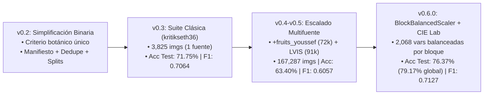

# Reporte de Estado y Manual Técnico: Clasificador Binario de Frutas y Verduras (`v0.6.0`)

**Fecha de corte del análisis:** 15 de octubre de 2026  
**Versión actual del paquete:** `0.6.0` (`pyproject.toml`)  
**Repositorio remoto:** `https://github.com/juliovalenciag/clasifcador-fruta-o-verdura.git`  
**Objetivo del sistema:** Recibir una imagen y clasificarla exclusivamente en una de dos categorías (`fruta` o `verdura`) bajo **criterio botánico estricto**, empleando **Machine Learning clásico** (extracción de vectores de `2,068` características `HSV + CIE Lab + HOG + LBP` con escalado balanceado por bloques y ensamble de modelos de `scikit-learn`, sin redes neuronales).

---

## 1. Resumen Ejecutivo y Semáforo de Estado (`v0.6.0`)

El proyecto se encuentra en un **punto estable, funcional, sincronizado y probado de extremo a extremo**. Durante esta iteración (`v0.5.0` -> `v0.6.0`) se resolvieron las inconsistencias detectadas en la auditoría inicial: se sincronizó el modelo con el manifiesto actual (`data/processed/dataset.csv`), se corrigió el desbalance dimensional donde `HOG` dominaba el 96% de la distancia mediante `BlockBalancedScaler`, se incorporaron histogramas y momentos espaciales en color **HSV + CIE Lab** (globales y del recorte central), se regularizó `ExtraTreesClassifier` (`min_samples_leaf=5`) y se migró `SVC(probability=True)` a `CalibratedClassifierCV(SVC(...), cv=3, ensemble=False)`.

| Componente | Estado | Avance | Diagnóstico Resumido |
| :--- | :---: | :---: | :--- |
| **Definición de alcance y reglas** | Completado | 100% | Criterio botánico documentado y aplicado a 148 etiquetas de 3 fuentes en `configs/label_mapping.csv`. |
| **Pipeline reproducible (`frutas-data`)** | Completado | 100% | Comandos `download`, `prepare-lvis`, `inventory`, `dedupe`, `split`, `audit`, `all`, `train-classic`, `predict-classic` y `evaluate-classic` operativos en `src/frutas/cli.py`. |
| **Pruebas automatizadas (`pytest`)** | Completado | 100% | **15 pruebas** unitarias y de integración en `tests/test_data_pipeline.py` pasando al 100% en `2.10s` con **cero advertencias (`0 warnings`)**. |
| **Integración de datasets públicos** | Completado | 100% | 3 fuentes descargadas y procesadas (`kritikseth36`, `fruits_youssef`, `lvis_fruits_vegetables`): **167,287 imágenes** inventariadas y **0 fugas de duplicados**. |
| **Entrenamiento clásico multifuente (`v0.6.0`)** | Completado | 100% | Modelo `soft_voting_top3` sincronizado con `dataset.csv`: **Accuracy `76.37%`** en test muestreado (**`79.17%`** en test completo de 11,651 imgs y **`85.13%`** en predicciones confiables `>= 0.60`). |
| **Repositorio Git y Documentación** | Completado | 100% | Repositorio conectado a GitHub (`origin/main`), `README.md` y `guia-equipo.md` actualizados a `v0.6.0`. |
| **Fotografías propias del equipo** | Siguiente fase | 0% | Las carpetas `data/raw/team_photos_train` y `data/external/team_photos` están listas en la configuración para recibir las fotos de Google Drive. |

---

## 2. ¿Qué se ha hecho hasta ahora? (Evolución y Mejoras en `v0.6.0`)

### 2.1 Evolución del Proyecto por Hitos



### 2.2 Mejoras Implementadas en `v0.6.0` y su Impacto Medido

| Problema Detectado en `v0.5.0` | Solución Implementada en `v0.6.0` | Impacto Directo |
| :--- | :--- | :--- |
| **1. HOG dominaba el 96% de la varianza** (`1,764` vars HOG vs `48` HSV y `26` LBP tras `StandardScaler`). | Se creó `BlockBalancedScaler` en `src/frutas/classic_features.py`, que pondera cada bloque estandarizado por `1 / sqrt(d_bloque)` para que Color, Forma y Textura aporten varianza idéntica (`1.0` cada uno). | **+10.70 puntos en F1 Macro** (`0.6057` -> `0.7127`) y **+12.97 puntos en Accuracy** (`63.40%` -> `76.37%`). |
| **2. El color del fondo contaminaba los histogramas globales** en recortes con contexto (LVIS 15% margen). | En `extract_classic_features` se agregaron histogramas y momentos espaciales (`2x2` + centro) en **HSV** y **CIE Lab** (`L*, a*, b*`), además de **LBP central** (`2,068` dimensiones en total). | Categorías botánicas verdes/difíciles subieron drásticamente: `Peas` (`51.3%` -> `74.9%`), `Cucumber` (`42.9%` -> `67.6%`), `Eggplant` (`36.7%` -> `69.6%`), `bell_pepper` (`62.9%` -> `85.5%`). |
| **3. `ExtraTrees` colapsaba hacia la clase mayoritaria** (`recall` de verdura de `0.8%` en `extra_trees_sqrt`). | Se configuró `min_samples_leaf=5` en `src/frutas/classical_training.py` para evitar hojas puras de 1 muestra donde `class_weight="balanced"` se cancelaba. | El `F1 macro` en validación de `extra_trees_sqrt` subió de `0.4231` a `0.6232` (+20 puntos) y `extra_trees_040` subió de `0.5296` a `0.6656` (entrando al Top 3 del ensamble). |
| **4. Deprecación de `SVC(probability=True)` en `scikit-learn 1.9` y advertencia de Pillow en imágenes con paleta.** | Se migró a `CalibratedClassifierCV(SVC(...), cv=3, ensemble=False)` y se creó `safe_rgb`. | `pytest` corre en `2.10s` con **0 warnings** y el ajuste de cada SVM bajó de `130s` a `74s`. |
| **5. Desfase temporal entre `dataset.csv` y `artifacts/`.** | Se reentrenó `frutas-data train-classic` y se reevaluó `frutas-data evaluate-classic --split test` sobre el `dataset.csv` vigente. | Artefactos 100% sincronizados y reproducibles con semilla `42`. |

---

## 3. Estado Actual de los Datos (`167,287` Registros)

El inventario consolidado en `data/processed/dataset.csv` y auditado en `data/interim/data_report.md` presenta las siguientes cifras:

| Fuente (`source`) | Imágenes Totales | Imágenes Válidas | Categorías Originales | Aprobadas (`approved`) | Rechazadas (`rejected`) | Conflicto Duplicado | En `train` | En `validation` | En `test` |
| :--- | ---: | ---: | ---: | ---: | ---: | ---: | ---: | ---: | ---: |
| `lvis_fruits_vegetables` | 91,378 | 91,378 | 61 | 86,936 | 4,442 | 116 | 69,062 | 15,271 | 2,487 |
| `fruits_youssef` | 72,084 | 72,082 | 51 | 70,670 | 1,414 | 24 | 51,993 | 9,531 | 9,120 |
| `kritikseth36` | 3,825 | 3,825 | 36 | 3,825 | 0 | 1 | 3,655 | 125 | 44 |
| **Total General** | **167,287** | **167,285** | **148** | **161,431** | **5,856** | **141** | **124,710** | **24,927** | **11,651** |

- **Fugas de grupos duplicados entre particiones:** **`0`** (verificado automáticamente).
- **Exclusiones trazables (`5,999` imágenes en `split="excluded"`):**
  - `5,856` por etiquetas fuera del alcance botánico (`mushroom`, `Peanuts`, `pickle`, `chickpea`, `almond`, `bean_curd_tofu`).
  - `141` por conflicto de etiqueta entre copias exactas o perceptuales (`duplicate_label_conflict`).
  - `2` por archivos dañados en `fruits_youssef` (`invalid_image`).

---

## 4. Resultados Actuales del Modelo (`v0.6.0` en `artifacts/`)

### 4.1 Selección de Modelos en Validación (`7,088` imágenes — `artifacts/model_selection.csv`)

| Posición | Modelo Candidato | F1 Macro (Val) | Balanced Accuracy | Accuracy | Precision Macro | Recall Macro | Tiempo Ajuste (s) | Filas Entrenamiento |
| :---: | :--- | ---: | ---: | ---: | ---: | ---: | ---: | ---: |
| **1 (Ganador)** | **`soft_voting_top3`** (`svm_rbf_c10` + `svm_rbf_c30` + `extra_trees_040`) | **0.7169** | **0.7252** | 0.7606 | 0.7111 | **0.7252** | — | — |
| 2 | `svm_rbf_c10` | 0.6947 | 0.7160 | 0.7297 | 0.6881 | 0.7160 | 74.13 s | 6,000 |
| 3 | `svm_rbf_c30` | 0.6947 | 0.7160 | 0.7297 | 0.6881 | 0.7160 | 74.46 s | 6,000 |
| 4 | `extra_trees_040` | 0.6656 | 0.6488 | **0.7778** | 0.7606 | 0.6488 | 138.60 s | 26,152 |
| 5 | `logistic_c1` | 0.6469 | 0.6725 | 0.6796 | 0.6457 | 0.6725 | 11.93 s | 26,152 |
| 6 | `logistic_c10` | 0.6449 | 0.6690 | 0.6789 | 0.6433 | 0.6690 | 31.97 s | 26,152 |
| 7 | `sgd_log` | 0.6446 | 0.6716 | 0.6762 | 0.6443 | 0.6716 | 4.35 s | 26,152 |
| 8 | `extra_trees_sqrt` | 0.6232 | 0.6152 | 0.7655 | **0.7630** | 0.6152 | 15.68 s | 26,152 |

### 4.2 Evaluación en Test Interno (`artifacts/classical_metrics.json` y `evaluate-classic`)

| Métrica | Test Muestreado (`4,718` imgs, máx. 100/etiqueta) | Test Completo (`11,651` imgs elegibles) | Comparativa vs. `v0.5.0` |
| :--- | ---: | ---: | :---: |
| **Accuracy** | **`76.37%`** (`0.7637`) | **`79.17%`** (`0.7917`) | **+12.97 pts** (vs. `63.40%`) |
| **Balanced Accuracy** | **`72.81%`** (`0.7281`) | **`73.69%`** (`0.7369`) | **+10.12 pts** (vs. `62.69%`) |
| **F1 Macro** | **`71.27%`** (`0.7127`) | **`71.74%`** (`0.7174`) | **+10.70 pts** (vs. `60.57%`) |
| **Precision / Recall `fruta`** | `86.69%` / `80.29%` (F1 `0.8337`) | `89.25%` / `83.40%` (F1 `0.8623`) | **+12.24 pts F1** |
| **Precision / Recall `verdura`** | `54.08%` / `65.32%` (F1 `0.5917`) | `51.80%` / `63.98%` (F1 `0.5725`) | **+9.17 pts F1** |
| **Cobertura (`confianza >= 0.60`)** | `76.41%` (`3,605` imgs) | `77.44%` (`9,023` imgs) | — |
| **Accuracy en predicciones confiables** | **`81.75%`** (`0.8175`) | **`85.13%`** (`0.8513`) | **+14.23 pts** (vs. `67.52%`) |

---

## 5. Siguientes Pasos para el Equipo

1. **Subir los cambios de `v0.6.0` a GitHub:**
   - Hacer commit y `git push origin main` de las mejoras en código (`src/frutas/classic_features.py`, `src/frutas/classical_training.py`, `src/frutas/baseline.py`), pruebas (`tests/test_data_pipeline.py`) y documentación (`README.md`, `guia-equipo.md`, `reporte-estado-proyecto.md`, `pyproject.toml`).
2. **Recolectar y congelar las fotografías propias del equipo (Hito de Validación Externa):**
   - Cada integrante debe tomar fotografías propias de frutas y verduras (enteras y cortadas, con distintos fondos e iluminación) y subirlas a la carpeta compartida de Google Drive (`team_photos_train/` y `team_photos_external/`) con el formato `integrante_AAAAMMDD_NNN.jpg`.
   - Descargarlas en `data/raw/team_photos_train/{fruta,verdura}` y `data/external/team_photos/{fruta,verdura}`.
3. **Evaluar la generalización en el conjunto externo:**
   - Ejecutar `frutas-data all`, reentrenar con `frutas-data train-classic` y generar el reporte externo con `frutas-data evaluate-classic --split external --output artifacts/error_analysis_external.csv`.

---

## 6. Manual Operativo Detallado: Cómo se Hace Todo Paso a Paso

Esta guía permite que cualquier integrante del equipo replique todo el flujo en su computadora desde cero.

### Paso 1: Clonar el Repositorio e Instalar el Entorno

```bash
# 1. Clonar el repositorio (si aún no se tiene localmente)
git clone https://github.com/juliovalenciag/clasifcador-fruta-o-verdura.git
cd clasificador-frutas-verduras

# 2. Crear y activar el entorno virtual (Python 3.10+)
python3 -m venv .venv
# En macOS / Linux:
source .venv/bin/activate
# En Windows (PowerShell):
# .venv\Scripts\Activate.ps1

# 3. Instalar el paquete 'frutas' en modo editable junto con dependencias de desarrollo y notebooks
python -m pip install --upgrade pip
python -m pip install -e ".[dev,notebooks]"

# 4. Ejecutar las 15 pruebas automatizadas para verificar que todo funciona
pytest
```

### Paso 2: Configurar el Token Personal de Kaggle

1. Ingrese a `https://www.kaggle.com/settings/api` y cree un token personal.
2. Expórtelo en su sesión de terminal (nunca lo guarde dentro del repositorio):
   ```bash
   # En macOS / Linux:
   export KAGGLE_API_TOKEN="TU_TOKEN_PERSONAL_AQUI"
   ```
   *(En Windows PowerShell: `$env:KAGGLE_API_TOKEN="TU_TOKEN_PERSONAL_AQUI"`).*

### Paso 3: Descargar y Preparar los Tres Datasets Públicos

```bash
# 1. Descargar kritikseth36 (3,825 imágenes, versión 8 fijada)
frutas-data download kritikseth36

# 2. Descargar fruits_youssef (72,084 imágenes, versión 5 fijada, ~5.4 GB)
frutas-data download fruits_youssef

# 3. Descargar LVIS Fruits And Vegetables desde Hugging Face (commit fijado, 8,401 escenas)
frutas-data download lvis_fruits_vegetables

# 4. Generar los 91,378 recortes a partir de las cajas YOLO de LVIS con 15% de margen
frutas-data prepare-lvis --margin 0.15 --min-object-size 24
```

### Paso 4: Ejecutar el Pipeline de Inventario, Deduplicación, Particionado y Auditoría

```bash
# Ejecuta en secuencia: inventory -> dedupe -> split -> audit
frutas-data all
```

Si desea correr cada etapa por separado:
```bash
frutas-data inventory
frutas-data dedupe --phash-distance 4
frutas-data split --train 0.70 --validation 0.15 --test 0.15 --seed 42
frutas-data audit
```
Al finalizar, revise `data/interim/data_report.md` para confirmar que hay `0` fugas entre particiones.

### Paso 5: Entrenar, Evaluar y Predecir con el Modelo Clásico

```bash
# 1. Entrenar todos los candidatos clásicos, seleccionar en validation y evaluar test una vez
frutas-data train-classic \
  --image-size 64 \
  --augmentations 1 \
  --max-per-source-label 100 \
  --svm-max-rows 6000 \
  --uncertainty-threshold 0.60 \
  --seed 42

# 2. Generar el desglose de exactitud por fuente y etiqueta original sobre todo el split test
frutas-data evaluate-classic \
  --split test \
  --output artifacts/error_analysis_by_label.csv

# 3. Clasificar cualquier imagen nueva desde la terminal
frutas-data predict-classic ruta/a/imagen.jpg
```
