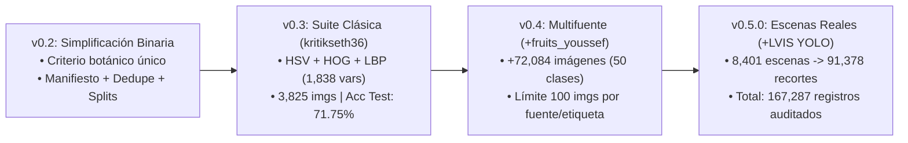

# Reporte de Estado y Manual Técnico: Clasificador Binario de Frutas y Verduras (`v0.5.0`)

**Fecha de corte del análisis:** 15 de octubre de 2026  
**Versión del paquete:** `0.5.0` (`pyproject.toml`)  
**Objetivo del sistema:** Recibir una imagen y clasificarla exclusivamente en una de dos categorías (`fruta` o `verdura`) bajo **criterio botánico estricto**, empleando **Machine Learning clásico** (extracción de vectores HSV + HOG + LBP y ensambles de modelos de `scikit-learn`, sin redes neuronales).

---

## 1. Resumen Ejecutivo y Semáforo de Estado

El proyecto cuenta con una **ingeniería de datos y de software sobresaliente**: tiene una interfaz de línea de comandos (`frutas-data`) modular, trazabilidad completa mediante manifiestos CSV inmutables, detección de duplicados exactos y perceptuales (SHA-256 + `pHash` con estructura `UnionFind`), particionado agrupado sin fuga de datos (*zero data leakage*), aumento de datos sintético en memoria y una suite de selección de modelos que aísla el conjunto de prueba (`test`).

| Componente | Estado | Avance | Diagnóstico Resumido |
| :--- | :---: | :---: | :--- |
| **Definición de alcance y reglas** | Completado | 100% | Criterio botánico documentado y aplicado a 148 etiquetas de 3 fuentes en `configs/label_mapping.csv`. |
| **Pipeline reproducible (`frutas-data`)** | Completado | 100% | Comandos `download`, `prepare-lvis`, `inventory`, `dedupe`, `split`, `audit`, `all`, `train-classic`, `predict-classic` y `evaluate-classic` operativos en `src/frutas/cli.py`. |
| **Pruebas automatizadas (`pytest`)** | Completado | 100% | 14 pruebas unitarias y de integración en `tests/test_data_pipeline.py` pasando al 100% (`2.84s`). |
| **Integración de datasets públicos** | Completado | 100% | 3 fuentes descargadas y procesadas (`kritikseth36`, `fruits_youssef`, `lvis_fruits_vegetables`): **167,287 imágenes** inventariadas. |
| **Entrenamiento clásico multifuente** | En ajuste | 85% | Modelo `soft_voting_top3` entrenado (`F1 macro = 0.6057`, `Accuracy = 63.40%`). **Requiere reentrenar** porque `dataset.csv` fue regenerado 7 minutos después del último entrenamiento. |
| **Fotografías propias del equipo** | Pendiente | 0% | Las carpetas `data/raw/team_photos_train` y `data/external/team_photos` aún no existen localmente (`external = null`). |
| **Repositorio Git local** | Pendiente | 0% | Existe `.gitignore`, pero **no se ha inicializado Git** (`.git` no existe en el directorio). |

---

## 2. ¿Qué se ha hecho hasta ahora? (Análisis Detallado)

### 2.1 Evolución del Proyecto por Hitos



1. **Fase 1 (`v0.2` – Simplificación binaria y contrato de datos):**
   - Se acotó el problema a `fruta` vs. `verdura` bajo criterio botánico: frutos derivados del ovario de la flor (incluyendo tomate, pepino, berenjena, calabaza, pimiento, chile, maíz, chícharo y ejote) son **`fruta`**; raíces, tubérculos, bulbos, tallos, hojas y flores (zanahoria, papa, cebolla, ajo, jengibre, lechuga, espinaca, brócoli, coliflor) son **`verdura`**.
   - Se excluyeron explícitamente hongos (`mushroom`), semillas secas/legumbres fuera de vaina (`almond`, `peanuts`, `chickpea`) y alimentos procesados (`pickle`, `bean curd/tofu`).
2. **Fase 2 (`v0.3` – Baseline y entrenamiento clásico en `kritikseth36`):**
   - Se implementó la extracción determinista de características en `src/frutas/classic_features.py` y el pipeline de entrenamiento con aumentos de ruido en memoria en `src/frutas/classical_training.py`.
   - En la corrida verificada sobre `kritikseth36` (3,825 imágenes; respaldada en `artifacts/classical_model_v0.3_seed42.zip`), el ensamble logró en test interno: **Accuracy de `71.75%`**, **Balanced Accuracy de `71.05%`**, **F1 Macro de `70.64%`** y **Accuracy en predicciones confiables (>= 0.60) de `76.55%`**.
3. **Fase 3 (`v0.4` y `v0.5.0` – Escalado multifuente con `fruits_youssef` y `LVIS`):**
   - Se integró `fruits_youssef` (versión 5 fijada en Kaggle, 72,084 imágenes en 50 categorías).
   - Se integró `henningheyen/LVIS_Fruits_And_Vegetables` desde Hugging Face (commit fijado `51362ad3...`), desarrollando `src/frutas/lvis.py` para recortar automáticamente cajas delimitadoras YOLO con un margen de contexto del 15% (`margin_ratio=0.15`) y tamaño mínimo de 24 píxeles, generando **91,378 recortes** a partir de 8,401 imágenes de escenas reales.

---

### 2.2 Arquitectura del Código (`src/frutas/`)

El código está estructurado como un paquete Python instalable (`src/frutas`) gobernado por el ejecutable `frutas-data`:

| Archivo | Responsabilidad Principal | Detalles Técnicos Clave |
| :--- | :--- | :--- |
| `src/frutas/config.py` | Rutas y configuración | Define `ProjectPaths` y valida `configs/datasets.yaml`. |
| `src/frutas/download.py` | Descarga reproducible | Descarga versiones fijas de Kaggle (`kagglehub`) y commits fijos de Hugging Face (`snapshot_download` + clon superficial Git sin LFS para metadatos `labels/`). Crea marcadores `.complete`. |
| `src/frutas/lvis.py` | Recortes YOLO a clasificación | Lee cajas YOLO de `data/raw/lvis_fruits_vegetables`, aplica margen de 15%, filtra objetos `< 24 px` y guarda recortes JPEG en `data/derived/lvis_fruits_vegetables/` junto con `crops_manifest.csv` y `.prepared.json`. |
| `src/frutas/manifest.py` | Inventario y validación | Escanea imágenes en paralelo (`ThreadPoolExecutor`), verifica integridad con Pillow, exige tamaño `>= 16x16`, calcula `sha256` y `phash` (`ImageHash`), y cruza con `configs/label_mapping.csv`. |
| `src/frutas/dedupe.py` | Deduplicación exacta y perceptual | Agrupa copias exactas (`sha256`) y visuales (`phash` con distancia de Hamming `<= 4`) usando `UnionFind` e indexación por segmentos de bits (principio del palomar en `d + 1` bloques para evitar costo cuadrático). Detecta conflictos si un grupo tiene tanto `fruta` como `verdura`. |
| `src/frutas/splits.py` | Particionado sin fugas | Asigna `train` (70%), `validation` (15%), `test` (15%) y `external` manteniendo cada `duplicate_group` unido en un mismo split. Respeta splits previos y `original_split`. |
| `src/frutas/audit.py` | Auditoría de calidad | Genera `data/interim/data_report.md` verificando 0 fugas entre splits, conteos por fuente/clase y etiquetas rechazadas. |
| `src/frutas/classic_features.py` | Extracción de características | Redimensiona a `64x64` y extrae un vector `float32` de **1,838 dimensiones**: Histograma HSV (48) + HOG sobre gris ecualizado (1,764) + LBP uniforme (26). |
| `src/frutas/baseline.py` | Modelo base rápido | Entrena un pipeline `StandardScaler` + `SGDClassifier(loss="log_loss", average=True)` para verificación rápida. |
| `src/frutas/classical_training.py` | Suite completa y ensamble | Aplica aumento de datos sintético en memoria a `train`, entrena 7 modelos + 1 ensamble `SoftVotingEnsemble` (top 3), selecciona el mejor en `validation` por **F1 macro**, reentrena en `train + validation` y evalúa `test` una sola vez. |

---

### 2.3 Estado Actual de los Datos (`data/processed/dataset.csv` y `data_report.md`)

El inventario actual consolida **167,287 imágenes** a través de las tres fuentes públicas activas:

| Fuente (`source`) | Imágenes Totales | Imágenes Válidas | Categorías Originales | Aprobadas (`approved`) | Rechazadas (`rejected`) | Conflicto Duplicado | En `train` | En `validation` | En `test` |
| :--- | ---: | ---: | ---: | ---: | ---: | ---: | ---: | ---: | ---: |
| `lvis_fruits_vegetables` | 91,378 | 91,378 | 61 | 86,936 | 4,442 | 116 | 69,062 | 15,271 | 2,487 |
| `fruits_youssef` | 72,084 | 72,082 | 51 | 70,670 | 1,414 | 24 | 51,993 | 9,531 | 9,120 |
| `kritikseth36` | 3,825 | 3,825 | 36 | 3,825 | 0 | 1 | 3,655 | 125 | 44 |
| **Total General** | **167,287** | **167,285** | **148** | **161,431** | **5,856** | **141** | **124,710** | **24,927** | **11,651** |

- **Integridad de particiones:** **0 grupos duplicados con fuga** entre `train`, `validation` y `test`.
- **Exclusiones aplicadas correctamente (5,999 imágenes en `split="excluded"`):**
  - `5,856` por pertenecer a categorías fuera del alcance (`mapping_not_approved`: `mushroom`, `Peanuts`, `pickle`, `chickpea`, `almond`, `bean_curd_tofu`).
  - `141` por conflicto de etiqueta entre duplicados (`duplicate_label_conflict`: imágenes visualmente idénticas o casi idénticas etiquetadas como fruta en un lugar y verdura en otro).
  - `2` por archivo de imagen inválido/corrupto en `fruits_youssef` (`invalid_image`).

---

### 2.4 Estado Actual del Modelo y Métricas (`artifacts/`)

En la última corrida de `frutas-data train-classic` (`artifacts/classical_metrics.json` y `artifacts/model_selection.csv`), se muestrearon hasta `--max-per-source-label 100` imágenes por combinación `(fuente, etiqueta_original)`, procesando `12,309` imágenes originales de entrenamiento (`24,618` vectores contando 1 aumento con ruido por imagen), `8,058` de validación y `8,021` de test.

#### Comparativa de Candidatos en Validación (`artifacts/model_selection.csv`)

| Posición | Modelo Candidato | F1 Macro (Val) | Balanced Accuracy | Accuracy | Precision Macro | Recall Macro | Tiempo Ajuste (s) | Filas Entrenamiento |
| :---: | :--- | ---: | ---: | ---: | ---: | ---: | ---: | ---: |
| **1 (Ganador)** | **`soft_voting_top3`** (`svm_rbf_c10` + `svm_rbf_c30` + `sgd_log`) | **0.5995** | **0.6218** | 0.6310 | 0.6029 | **0.6218** | — | — |
| 2 | `svm_rbf_c10` | 0.5989 | 0.6105 | 0.6433 | 0.5975 | 0.6105 | 130.53 s | 6,000 |
| 3 | `svm_rbf_c30` | 0.5989 | 0.6105 | 0.6433 | 0.5975 | 0.6105 | 130.28 s | 6,000 |
| 4 | `sgd_log` | 0.5855 | 0.6090 | 0.6155 | 0.5915 | 0.6090 | 19.59 s | 24,618 |
| 5 | `logistic_c1` | 0.5764 | 0.5961 | 0.6097 | 0.5812 | 0.5961 | 24.90 s | 24,618 |
| 6 | `logistic_c10` | 0.5756 | 0.5954 | 0.6090 | 0.5805 | 0.5954 | 25.37 s | 24,618 |
| 7 | `extra_trees_040` | 0.5296 | 0.5577 | **0.7383** | 0.7969 | 0.5577 | 192.09 s | 24,618 |
| 8 | `extra_trees_sqrt` | 0.4231 | 0.5039 | 0.7102 | **0.8298** | 0.5039 | 14.87 s | 24,618 |

#### Desempeño del Modelo Ganador (`soft_voting_top3`) en Test Interno (`8,021` imágenes)

- **Accuracy global:** `63.40%` (`0.6340`)
- **Balanced Accuracy:** `62.69%` (`0.6269`)
- **F1 Macro:** `60.57%` (`0.6057`)
- **Desempeño por clase:**
  - **`fruta`** (soporte: 5,612): Precision = `79.35%`, Recall = `64.45%`, F1 = `71.13%`
  - **`verdura`** (soporte: 2,409): Precision = `42.39%`, Recall = `60.94%`, F1 = `50.00%`
- **Filtro de incertidumbre (`confidence >= 0.60`):** Cobertura del **`79.15%`** de las imágenes, elevando el Accuracy a **`67.52%`** en predicciones confiables.
- **Matriz de confusión en Test (filas = real, columnas = predicho `[fruta, verdura]`):**

| Real \ Predicho | `fruta` | `verdura` | Total Real |
| :--- | ---: | ---: | ---: |
| **`fruta`** | **3,617** | 1,995 | 5,612 |
| **`verdura`** | 941 | **1,468** | 2,409 |

#### Análisis de Errores por Categoría Original (`artifacts/error_analysis_by_label.csv`)

Las categorías con menor exactitud explican por qué el clasificador clásico se confunde al pasar de 1 dataset a 3 datasets:
1. **Frutas botánicas verdes, alargadas o de uso culinario salado** que comparten color y silueta con verduras:
   - `peas` (`kritikseth36`: `28.6%` acc), `cucumber` (`kritikseth36`: `29.4%`, `fruits_youssef`: `42.9%`), `gourd` (`lvis`: `33.3%`), `corn` (`kritikseth36`: `35.3%`, `fruits_youssef`: `46.9%`), `eggplant` (`kritikseth36`: `36.0%`, `fruits_youssef`: `36.7%`), `soy beans` (`43.5%`), `chili_pepper` / `jalapeno` (`45.5%`–`46.7%`), `okra` (`45.9%`).
2. **Recortes pequeños de escenas complejas en `lvis_fruits_vegetables`:**
   - `date` (`0%` en 2 imgs), `coconut` (`20.0%`), `brussels_sprouts` (`37.5%`), `green_onion` (`39.0%`), `radish` (`39.5%`), `broccoli` (`39.9%` en 1,548 imgs), `carrot` (`40.1%` en 1,311 imgs).

---

## 3. Hallazgos Críticos Detectados en la Auditoría

> [!WARNING]
> **Hallazgo Crítico 1: Desfase de 7 minutos entre el modelo entrenado y `dataset.csv`**  
> Al inspeccionar las marcas de tiempo del sistema de archivos:
> - `artifacts/classical_model.joblib` y `classical_metrics.json` fueron creados el **15 de octubre a las `21:54`**.
> - `artifacts/error_analysis_by_label.csv` fue creado a las **`22:00`** (evaluando 24,057 imágenes de `test`).
> - `data/processed/dataset.csv` y `data/interim/data_report.md` fueron regenerados a las **`22:01`** tras cambiar `splits.py` para usar `original_split` (dejando `11,651` imágenes en `test`).  
> **Impacto:** El modelo guardado actualmente en `artifacts/classical_model.joblib` fue entrenado con una partición anterior distinta a la que hoy está en `data/processed/dataset.csv`. **Se debe volver a correr `frutas-data train-classic` y `frutas-data evaluate-classic`** para que los artefactos queden 100% sincronizados con `dataset.csv`.

> [!IMPORTANT]
> **Hallazgo Crítico 2: Desbalance dimensional en el vector de características (HOG domina el 96% del peso)**  
> En `src/frutas/classic_features.py`, cada imagen produce `1,838` variables:
> - **HSV (Color):** `48` variables (`2.6%` del vector).
> - **HOG (Bordes/Gradientes):** `1,764` variables (`96.0%` del vector).
> - **LBP (Textura):** `26` variables (`1.4%` del vector).  
> Como `StandardScaler()` estandariza cada una de las 1,838 columnas a varianza 1 por igual, la distancia euclidiana en `SVM RBF` y el producto punto en `LogisticRegression`/`SGD` están **dominados en un 96% por la forma de los bordes (HOG)** y casi ignoran el color (HSV) y la textura (LBP). En escenas con ruido como LVIS, donde los bordes del fondo cambian constantemente pero el color y la textura superficial son discriminativos, esto reduce significativamente el F1 macro.

> [!IMPORTANT]
> **Hallazgo Crítico 3: Desbalance 69% / 31% tras `--max-per-source-label 100` y colapso de `ExtraTrees`**  
> Existen muchas más etiquetas originales de `fruta` (97 aprobadas) que de `verdura` (44 aprobadas). Al limitar a 100 imágenes por `(source, original_label)` sin limitar por clase (`--max-per-class 0`), el conjunto muestreado queda con **69% `fruta` y 31% `verdura`** (`9,015` vs `4,061` en `train`). Esto provoca que `extra_trees_sqrt` sobreajuste hojas puras hacia la clase mayoritaria y prediga `fruta` el 99.7% de las veces en validación (`5,704` vs `1` para frutas y `2,334` errores vs `19` aciertos en verduras, con recall de `0.008`).

> [!NOTE]
> **Hallazgo 4: Contracción del split `test` de `kritikseth36` (`577` -> `44` imágenes)**  
> El dataset original `kritikseth36` en Kaggle contiene cientos de imágenes duplicadas entre sus carpetas `train/`, `validation/` y `test/`. Al activar la preservación de `original_split` en `src/frutas/splits.py`, los grupos de duplicados que cruzaban particiones se unificaron por voto mayoritario hacia `train`. Esto evitó fugas de datos, pero dejó a `kritikseth36` con solo `44` imágenes en `test` y `125` en `validation`.

> [!NOTE]
> **Hallazgo 5: Deprecación en `scikit-learn` y falta de repositorio Git local**  
> 1. Al correr `pytest`, `scikit-learn` emite un `FutureWarning` porque `SVC(probability=True)` fue deprecado en `1.9` y se eliminará en `1.11` en favor de `CalibratedClassifierCV(SVC(), ensemble=False)`.
> 2. La carpeta del proyecto aún no tiene un repositorio Git inicializado (`git init` / `git remote add`).

---

## 4. Siguientes Pasos Recomendados para el Equipo

### Prioridad 1: Sincronización Inmediata y Control de Versiones (Corto Plazo)
1. **Reentrenar el modelo con la partición actual (`dataset.csv`):** Ejecutar `frutas-data train-classic` y `frutas-data evaluate-classic --split test` para eliminar el desfase de 7 minutos entre `dataset.csv` y `artifacts/`.
2. **Inicializar Git y subir a GitHub:** Ejecutar `git init`, verificar con `git status` que `data/` y `artifacts/` estén ignorados gracias a `.gitignore`, y hacer el primer commit oficial de la versión `0.5.0`.

### Prioridad 2: Recolección y Evaluación del Test Externo del Equipo (Hito Obligatorio)
3. **Capturar y organizar las fotos reales del equipo:**
   - Subir a Google Drive las fotos tomadas por los integrantes en `team_photos_train/{fruta,verdura}` y `team_photos_external/{fruta,verdura}` siguiendo el formato `integrante_AAAAMMDD_NNN.jpg`.
   - Descargarlas en `data/raw/team_photos_train/` y `data/external/team_photos/`.
   - **Regla de oro:** Congelar `data/external/team_photos/` antes de reentrenar y **nunca** mover fotos de `external` a `train` ni usar `external` para ajustar hiperparámetros.
4. **Volver a correr el pipeline de datos y evaluar generalización:**
   - Ejecutar `frutas-data all` (preservará los splits actuales y asignará las fotos nuevas) seguido de `frutas-data train-classic` y `frutas-data evaluate-classic --split external`.

### Prioridad 3: Mejoras Técnicas para Subir el F1 Macro (> 0.72) en Multifuente
5. **Re-ponderar bloques de características (HSV, HOG, LBP):**
   - En lugar de aplicar un único `StandardScaler()` donde HOG tiene 1,764 columnas y HSV solo 48, escalar cada bloque y dividir cada bloque por la raíz cuadrada de su número de columnas (normalización por bloque), o agregar histogramas HSV espaciales (por ejemplo, cuadrícula `2x2` + centro para separar el color del objeto del color del fondo).
6. **Balancear el muestreo entre `fruta` y `verdura`:**
   - Usar `--max-per-class` junto con `--max-per-source-label`, o ajustar la cuota de muestreo para que `train` tenga 50% `fruta` y 50% `verdura`.
7. **Regularizar `ExtraTreesClassifier` y actualizar `SVC`:**
   - Añadir `min_samples_leaf=5` o `max_depth=25` en `extra_trees_sqrt` para que `class_weight="balanced"` surta efecto en las probabilidades de las hojas.
   - Reemplazar `SVC(probability=True)` por `CalibratedClassifierCV(SVC(...), ensemble=False)` en `src/frutas/classical_training.py` para eliminar el `FutureWarning` de `scikit-learn`.

---

## 5. Manual Operativo Detallado: Cómo se Hace Todo Paso a Paso

Esta sección está diseñada para que cualquier integrante del equipo pueda replicar el proyecto desde cero en su computadora (macOS, Linux o Windows).

### Paso 1: Clonar e Instalar el Entorno

Abra una terminal en la carpeta del proyecto y ejecute:

```bash
# 1. Crear el entorno virtual de Python (requiere Python 3.10 o superior)
python3 -m venv .venv

# 2. Activar el entorno virtual
# En macOS / Linux:
source .venv/bin/activate
# En Windows (PowerShell):
# .venv\Scripts\Activate.ps1

# 3. Actualizar pip e instalar el paquete 'frutas' en modo editable con dependencias de test y notebooks
python -m pip install --upgrade pip
python -m pip install -e ".[dev,notebooks]"

# 4. Verificar que la instalación y las 14 pruebas automáticas funcionen correctamente
pytest
```

### Paso 2: Configurar Credenciales de Kaggle (Solo 1 vez por integrante)

Para descargar `kritikseth36` y `fruits_youssef` desde Kaggle sin guardar secretos en el código:

1. Inicie sesión en `https://www.kaggle.com/settings/api` y genere un token personal.
2. Expórtelo como variable de entorno en su terminal (nunca lo escriba en archivos del repositorio):
   ```bash
   # En macOS / Linux:
   export KAGGLE_API_TOKEN="TU_TOKEN_PERSONAL_AQUI"
   ```
   *(En Windows PowerShell: `$env:KAGGLE_API_TOKEN="TU_TOKEN_PERSONAL_AQUI"`).*

### Paso 3: Descargar y Preparar los Datasets Públicos

El comando `frutas-data download` descarga exactamente la versión o commit fijado en `configs/datasets.yaml`. Si un dataset ya se descargó antes (marcador `.complete`), el comando lo detecta y no vuelve a descargarlo:

```bash
# 1. Descargar dataset base (3,825 imágenes, 36 categorías, versión 8)
frutas-data download kritikseth36

# 2. Descargar segundo dataset masivo (72,084 imágenes, 50 categorías, versión 5, ~5.4 GB)
frutas-data download fruits_youssef

# 3. Descargar dataset de escenas reales LVIS desde Hugging Face (8,401 escenas con cajas YOLO)
frutas-data download lvis_fruits_vegetables

# 4. Convertir las cajas YOLO de LVIS en 91,378 recortes individuales con 15% de contexto
frutas-data prepare-lvis --margin 0.15 --min-object-size 24
```

### Paso 4: Incorporar las Fotografías del Equipo (Google Drive)

Cuando el equipo haya subido sus fotografías a la carpeta compartida de Google Drive:

1. Descargue `team_photos_train` y coloque las imágenes en:
   - `data/raw/team_photos_train/fruta/`
   - `data/raw/team_photos_train/verdura/`
2. Descargue `team_photos_external` (conjunto congelado de evaluación externa) y colóquelas en:
   - `data/external/team_photos/fruta/`
   - `data/external/team_photos/verdura/`

### Paso 5: Ejecutar el Pipeline de Inventario, Deduplicación, Splits y Auditoría

Puede ejecutar las 4 etapas de preparación de datos con un solo comando:

```bash
frutas-data all
```

O bien ejecutarlas paso por paso para inspeccionar cada resultado intermedio:

```bash
# Etapa 5.1: Escanear imágenes, validar formato/dimensiones, calcular SHA-256 + pHash y mapear a fruta/verdura
# -> Genera: data/interim/manifest.csv
frutas-data inventory

# Etapa 5.2: Agrupar copias exactas y perceptuales (distancia de Hamming <= 4) y marcar conflictos de clase
# -> Genera: data/interim/manifest_deduplicated.csv y data/interim/duplicate_candidates.csv
frutas-data dedupe --phash-distance 4

# Etapa 5.3: Asignar particiones (70% train, 15% validation, 15% test, más external) sin separar grupos duplicados
# -> Genera: data/processed/dataset.csv (conserva splits previos salvo que se pase --reset)
frutas-data split --train 0.70 --validation 0.15 --test 0.15 --seed 42

# Etapa 5.4: Generar el reporte de auditoría en Markdown
# -> Genera: data/interim/data_report.md
frutas-data audit
```

> [!TIP]
> **Verificación antes de entrenar:** Abra `data/interim/data_report.md` y confirme que **Grupos con fuga entre particiones** sea **`0`** y que no aparezcan etiquetas con estado `unmapped`.

### Paso 6: Entrenar el Clasificador Clásico

Para entrenar la suite completa de modelos clásicos (Regresión Logística `C in {1, 10}`, SGD Log-Loss, SVM RBF `C in {10, 30}`, Extra Trees y el ensamble `soft_voting_top3`):

```bash
frutas-data train-classic \
  --image-size 64 \
  --augmentations 1 \
  --max-per-source-label 100 \
  --svm-max-rows 6000 \
  --uncertainty-threshold 0.60 \
  --seed 42
```

**¿Qué hace este comando internamente?**
1. Filtra únicamente imágenes válidas (`valid=True`), aprobadas (`mapping_status=approved`) y sin conflictos de duplicados.
2. Toma hasta `100` imágenes por combinación `(fuente, etiqueta_original)` en cada split para evitar que categorías gigantes (como `banana` con 13,814 recortes en LVIS) monopolicen el entrenamiento.
3. Extrae el vector de `1,838` características (`HSV + HOG + LBP`) de cada imagen y genera `1` variante con ruido sintético en memoria (recorte aleatorio, espejo, rotación `+/- 22 grados`, variación de brillo/contraste/color, desenfoque gaussiano y ruido normal de sensor) exclusivamente para `train`.
4. Entrena los 7 modelos individuales y construye `soft_voting_top3` con los 3 mejores en `validation` según `f1_macro`.
5. Reentrena el modelo ganador usando `train + validation` y evalúa una sola vez en `test` (y en `external` si hay fotos del equipo).
6. Guarda:
   - `artifacts/classical_model.joblib` (modelo final listo para producción/inferencia).
   - `artifacts/classical_metrics.json` (métricas detalladas, reporte por clase y matrices de confusión).
   - `artifacts/model_selection.csv` (tabla comparativa de todos los candidatos).

*(Nota: Si solo desea correr una prueba rápida en segundos con un único modelo lineal SGD, puede usar `frutas-data train-baseline --image-size 64 --max-per-class 1000`).*

### Paso 7: Evaluar Errores por Especie y Predecir en Imágenes Nuevas

1. **Desglosar el desempeño por fuente y etiqueta original** (para identificar qué frutas o verduras fallan más):
   ```bash
   # Evaluar en el conjunto de prueba interno:
   frutas-data evaluate-classic --split test --output artifacts/error_analysis_by_label.csv

   # Evaluar en las fotos externas del equipo (cuando estén listas):
   frutas-data evaluate-classic --split external --output artifacts/error_analysis_external.csv
   ```

2. **Predecir una imagen individual desde la terminal:**
   ```bash
   frutas-data predict-classic ruta/a/mi_imagen.jpg
   ```
   **Ejemplo de respuesta JSON:**
   ```json
   {
     "prediction": "fruta",
     "confidence": 0.7842,
     "probabilities": {
       "fruta": 0.7842,
       "verdura": 0.2158
     },
     "uncertain": false,
     "model": "soft_voting_top3"
   }
   ```
   Si `confidence < 0.60`, el campo `"uncertain"` será `true` para advertir baja confianza sin dejar de emitir una predicción binaria.

### Paso 8: Uso de los Notebooks Interactivos

El proyecto incluye dos notebooks limpios en `notebooks/`:
- `notebooks/01_exploracion_datos.ipynb`: Carga `data/processed/dataset.csv`, resume conteos por `split`, `source` y `class_id`, grafica la distribución de clases y muestra una cuadrícula `3x4` de imágenes reales con su clase binaria y etiqueta original.
- `notebooks/02_baseline_clasico.ipynb`: Ejecuta el baseline rápido y visualiza las métricas desde `artifacts/binary_baseline_metrics.json`.
